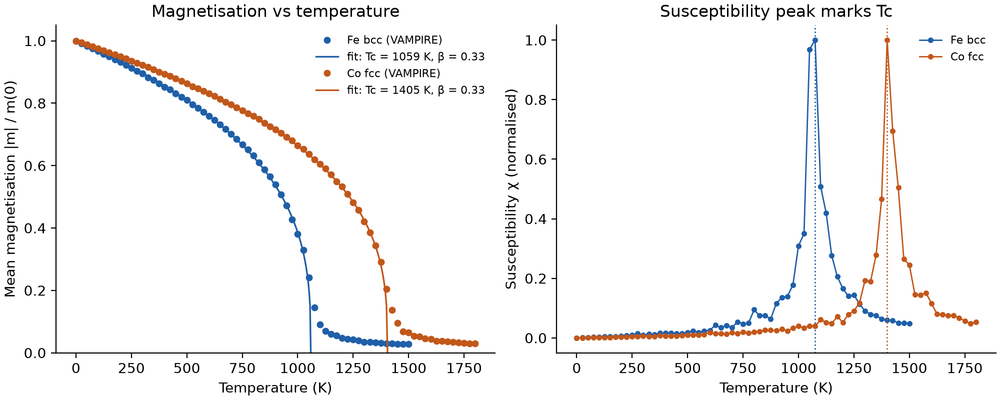

# Curie temperature of Fe and Co with VAMPIRE

Atomistic spin simulation on Linux (Ubuntu on WSL2): I compiled VAMPIRE (https://vampire.york.ac.uk) from source and used Monte Carlo temperature sweeps to calculate the Curie temperature (Tc) of bcc iron and cobalt.

## Results

| System | Tc from susceptibility peak (K) | Tc from fit (K) | beta | Experiment (K) |
|---|---|---|---|---|
| Fe (bcc) | 1075 | 1059 | 0.33 | 1043 |
| Co | 1400 | 1405 | 0.33 | 1388 |

With nearest-neighbour exchange constants from the literature, both Tc values are within 2% of experiment. The fitted exponent beta = 0.33 is close to the 3D Heisenberg value (0.36).

## Method

Classical Heisenberg model on a 4 x 4 x 4 nm periodic crystal (5,488 Fe or 6,912 Co atoms). At each temperature: 2,000 Monte Carlo steps to equilibrate, 3,000 to average |m| and susceptibility. Tc from the susceptibility peak and from a fit of m(T) = (1 - T/Tc)^beta.

## Reproduce (Ubuntu)

    sudo apt install -y build-essential git python3-venv
    python3 -m venv ~/vampire-env && source ~/vampire-env/bin/activate
    pip install numpy matplotlib
    git clone https://github.com/richard-evans/vampire.git ~/vampire
    cd ~/vampire && git checkout 525bc27 && make serial -j$(nproc) && cd -
    export PATH="$HOME/vampire:$PATH"
    bash scripts/run_sweep.sh inputs/Fe_bcc inputs/Co_fcc
    python scripts/analyse.py results/Fe_bcc results/Co_fcc

## References

- R. F. L. Evans et al., J. Phys.: Condens. Matter 26, 103202 (2014)
- R. F. L. Evans et al., Phys. Rev. B 91, 144425 (2015)
